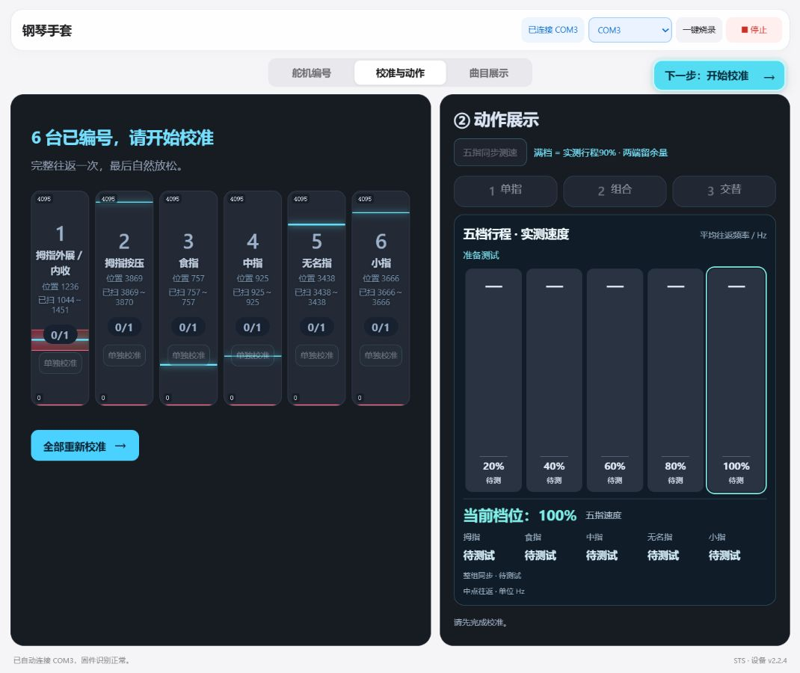
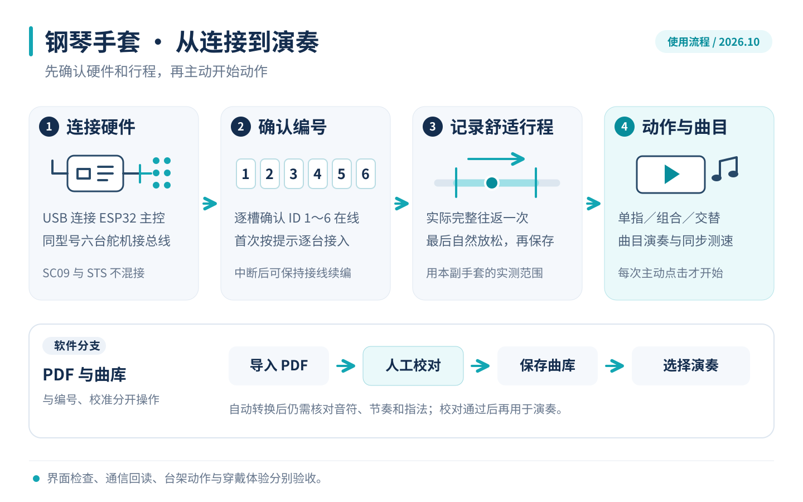
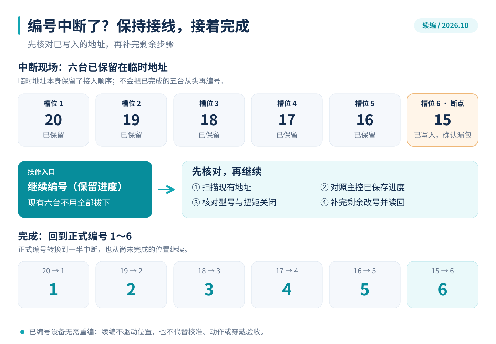
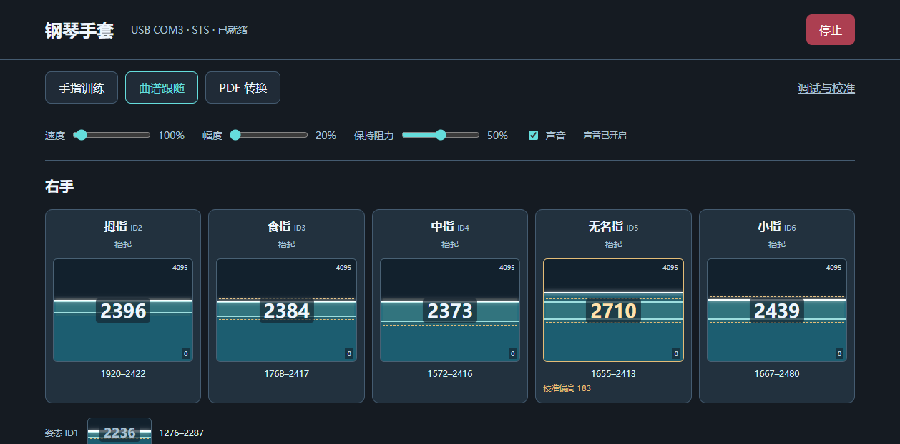
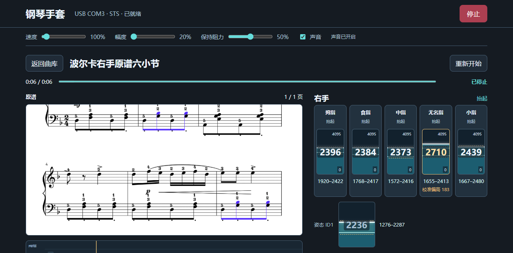
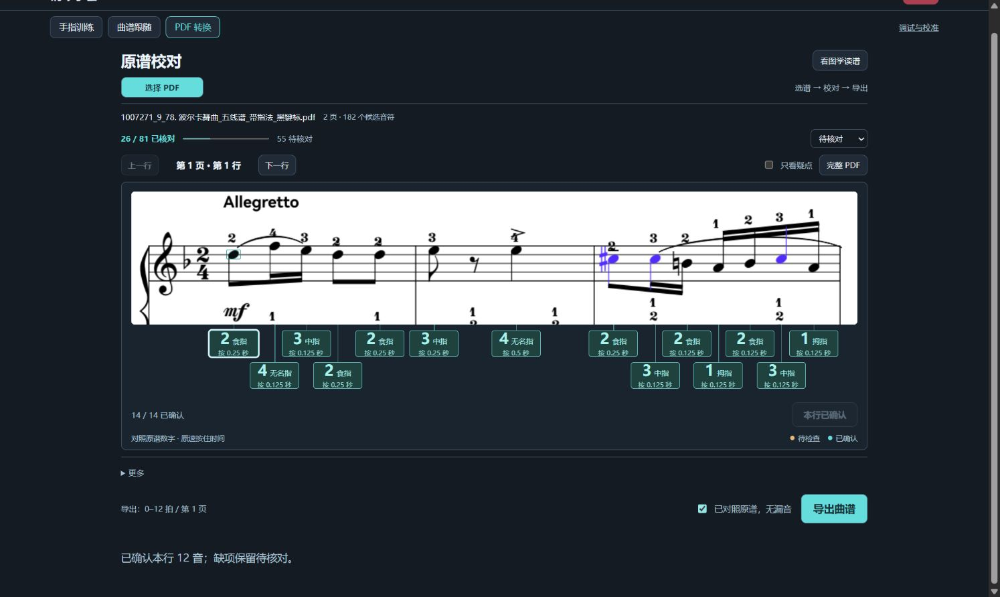
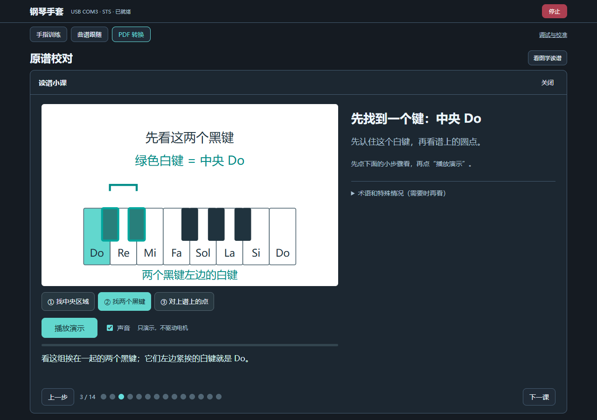
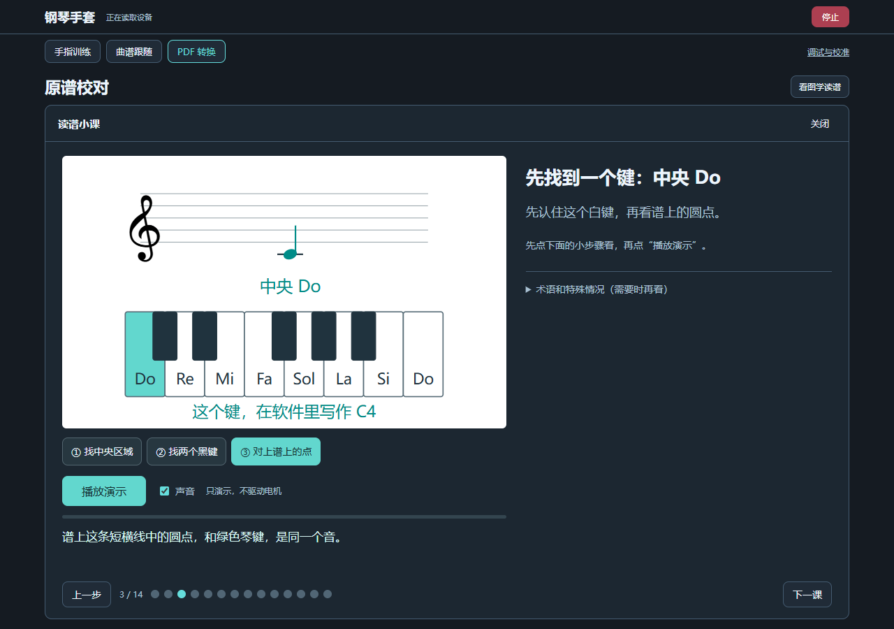

# 六自由度钢琴手套 · Piano Glove

用 ESP32 和六路总线舵机驱动手指，提供本机调试、舒适行程校准、手指训练、曲谱跟随和读谱教程。支持 **SC09 / STS3032-C001** 两套同型号装置。

**[下载源码 ZIP](https://github.com/cdh66666/piano-glove/archive/refs/heads/main.zip)** · **[图解使用指南](docs/ILLUSTRATED-GUIDE.md)** · **[完整操作与维护](docs/LLM-START-HERE.md)**

**给客户使用：[下载 Windows 免 Python 运行包](https://github.com/cdh66666/piano-glove/releases/download/windows-driver-20261021/PianoGlove-Windows-20261021.zip)**。解压后双击 `01-打开软件.bat`；缺驱动时在网页点“自动安装并连接”，其余自动处理。



## 这次更新 · 2026-10-21

- **客户电脑缺少驱动，一键自动处理**：页面识别无 COM 口的 CP2102，点一次“自动安装并连接”，自动下载官方驱动、校验签名、安装并恢复连接。Windows 管理员授权由使用者确认；正常已有驱动不重复安装。[首次连接说明](docs/USB-DRIVER-SETUP.md)。

- **编号中断可以接着完成**：点击“继续编号（保留进度）”，保留六台现有接线；不必全部拔下重新编号。现场已将临时地址 15～20 续编为正式 1～6。
- **改号后重复读回确认**：一次漏回应不立即终止整轮，也不会盲目重复写入 ID。
- 同步手指训练、主控曲库、PDF 原谱校对和 **14 课 / 40 小步骤**读谱教程源码。
- 新增 **7 张实际界面截图 + 2 张中文流程图**；截图日期和适用范围见[图片说明](docs/images/README.md)。

## 从连接到使用



### 两个页面，共用同一个串口桥

| 页面 | 用途 | 启动入口 |
|---|---|---|
| 调试台 | 连接、编号与续编、校准、单指/组合/交替、测速 | `host/start-debug.bat` |
| 训练软件 | 手指训练、曲库与原谱跟随、PDF 人工校对、读谱小课 | `host/start-software.bat` |

Windows 安装 Python **3.10+** 并加入 PATH，解压源码后双击相应入口。首次启动安装 `host/requirements.txt` 中的依赖。已有同版服务时复用；同一个主控只运行一个串口桥。

也可在仓库根目录手动启动：

```powershell
python -m pip install -r host/requirements.txt
python host/bridge.py --no-auto
```

然后打开：

- 调试台：<http://127.0.0.1:8123/web_piano_glove.html?simple=1>
- 训练软件：<http://127.0.0.1:8123/software.html>

使用 `--no-auto` 时，在网页选择主控 COM 口。打开页面、重新连接和固件更新不会自动恢复运动目标。软件运行在本机；仓库更新不自动发布公网控制站点。

## 编号中断，保持接线继续



1. 已经接好的舵机保持原样；主控 USB 若断开，只重新连接 USB。
2. 在“舵机编号”页点击 **继续编号（保留进度）**。
3. 程序核对已保存的槽位和现场地址，补完未确认步骤；六台齐全后完成正式 ID1～6。
4. 页面显示 **6 台已编号** 后进入校准。“重新编号”用于从头改变接入顺序。

全新舵机可能都使用同一个出厂 ID，首次编号仍须按提示逐台接入；续编利用本次已写入的临时地址与保存进度。详细实现、测试和现场结果见[续编修复记录](docs/ENROLLMENT-RESUME-20261021.md)。

## 界面一览

以下训练与教程截图摄于 2026-10-14～15，展示实际开发验证中的界面；它们不是当前装置正在运动的画面。

| 手指状态与训练 | 原谱跟随 |
|---|---|
|  |  |
| 显示各指位置与已记录范围，ID1 单列为姿态轴。 | 原谱、曲目进度、反馈同屏；图中已停止。 |

### PDF 先校对，再导出



把待核对的右手音符放在原谱下方，逐项确认指法与时值。当前识别针对支持的矢量谱格式；扫描件或其他排版可能无法识别。**识别候选数量不代表识谱准确率，未复核的内容不当作可执行曲谱。**

### 读谱小课：一次解释一个概念

| 找到中央 Do | 对上谱中的音符 |
|---|---|
|  |  |

<details>
<summary>查看手机窄屏界面</summary>

<p align="center"></p>

教程中的播放只演示图形与声音，不驱动舵机。

</details>

## 硬件与六路映射

主控为微雪 **Servo Driver with ESP32（SKU 21593）**，USB 串口 115200；舵机总线 GPIO18 RX / GPIO19 TX，默认 1 Mbps。舵机按装置使用独立供电，一条总线使用同型号舵机。硬件细节见 [hardware/README.md](hardware/README.md)。

| ID | 用途 |
|---|---|
| 1 | 拇指外展 / 内收，演奏姿态 |
| 2 | 拇指按压 |
| 3～6 | 食指、中指、无名指、小指 |

当前固定结构的六轴按下方向均为 `min`，以当前源码和实际装配为准。不同型号、安装或佩戴者的行程须实测，不能复制示例端点。校准结束的自然放松位置用于记录待机位。SC09 的安装中位流程与 STS 的电气原点流程分别处理。

## 固件与源码

固件协议版本为 `PIANO_GLOVE_2 v2.2.4`；本次续编修复另由 `INFO` 中的 `enroll_resume=1 enroll_fix=20261021` 区分。

```powershell
pio run -d firmware
```

`firmware/embed_ui.py` 在编译前从 `host/software*` 生成嵌入页面，生成头文件不入库。新增的 `WebServerBinary` 保留上游来源和完整 LGPL 许可证。烧录与设备操作见[完整维护流程](docs/LLM-START-HERE.md)。

| 目录 | 内容 |
|---|---|
| `host/` | 串口桥、网页、曲谱格式、PDF 校对和启动入口 |
| `firmware/` | ESP32 固件、主控曲库、编号恢复及嵌入页面生成 |
| `docs/` | 图解、流程、历史验证记录 |
| `tools/` | Windows 运行包构建与固件升级工具源码 |

## 验证范围

本次发布准备通过 **410 项 Node 测试、258 项 Python 测试**；编号恢复另有原生 C++ 状态机与真实 I/O 测试，包含原 720 个编号排列和各恢复断点。

2026-10-21 的现场续编已确认：六台保持接线，最终 ID1～6、六槽在线、扭矩关闭、EEPROM 锁定。数字测试与编号读回不替代穿戴、落键、舒适度或带载验收。既有速度数据保留在[历史双型号台架记录](docs/DUAL-BENCH-20261005.md)，不作为所有装置的性能承诺。

原始串口日志、校准轨迹、Flash/NVS 备份和客户资料保留在本机，仓库只收录选定的界面截图和技术说明。
