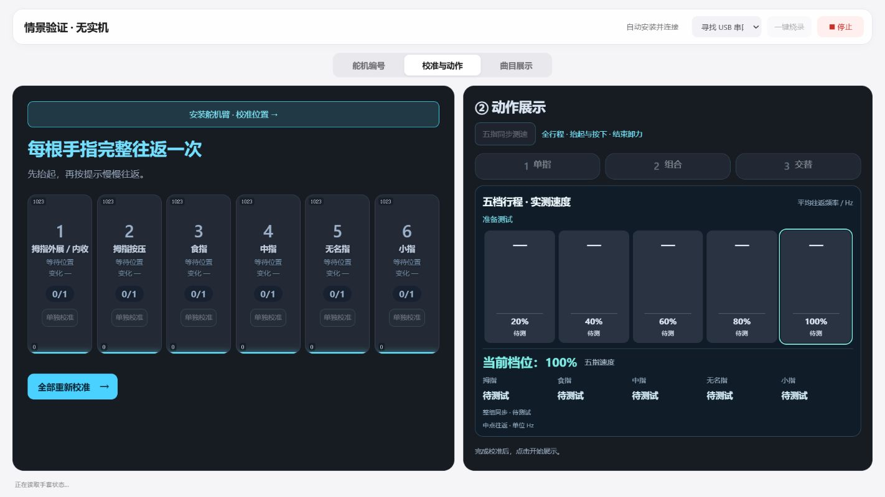

# 客户电脑首次连接：串口驱动自动处理

主控板板载的 CP2102 需要 Silicon Labs CP210x 串口驱动。缺少驱动时，Windows 设备管理器可能把它放在“其他设备”并显示黄色感叹号，网页也不会得到可选择的 COM 口。

## 点击一次，处理驱动并继续连接

1. 用 USB 数据线连接主控，保持原有舵机接线与供电方式。
2. 顶部连接按钮发现缺驱动后会变为 **自动安装并连接**，点击一次即可；没有额外提示框。
3. 程序优先从 Silicon Labs 官方地址取得驱动包；常见 64 位 Windows 在该站不可达时自动使用微软 Windows Update 官方备用包。校验对应硬件和可信数字签名后启动 Windows 驱动安装。
4. **Windows 弹出 UAC 管理员权限窗口时，客户本人确认“是”。** 网页不能替代或绕过这个系统确认；若使用标准账户，可能需要该电脑管理员输入凭据。
5. 安装结束后，调试台自动重新检测 USB 和 COM 口，再连接主控。无需关闭页面或手工查找 COM 号。

驱动下载和安装状态由页面显示。取消系统确认、下载失败、安装失败或系统要求重启时，按页面明确结果处理，不把“安装程序已启动”显示为“已连接”。

这个入口不卸载现有串口驱动，不自动烧录固件、不修改舵机编号，也不执行位置动作。驱动就绪后的连接仍只核对设备与固件状态；原有运动目标不会自动恢复。

## 提示如何区分

| 检测结果 | 含义 |
|---|---|
| 已找到主控，但尚未安装串口驱动 | Windows 已发现目标 USB，设备问题代码为 28；即使没有 COM 口也能提示。 |
| 主控 USB 驱动或设备异常 | 设备报告其他问题代码，不直接断言为“没装驱动”。 |
| CP210x 串口驱动已就绪 | 已出现该项目支持的串口，可以继续连接；若接多块主控，仍须选择正确设备。 |
| 尚未检测到主控 USB | 系统暂未看到目标 USB；先检查 USB 接入和数据线。 |
| 暂时无法检测串口驱动 | 系统诊断读取失败或当前平台不支持该项读取，不能据此断定未安装驱动。 |

电脑同时接多块主控时，一块出现 COM 口不代表另一块也正常。诊断会保留各个目标 USB 的问题代码；安装后的新 COM 口优先于短时缓存的旧诊断结果。

## 官方来源与手动备用入口

- [Silicon Labs CP210x 驱动页面](https://www.silabs.com/software-and-tools/usb-to-uart-bridge-vcp-drivers)
- [官方 CP210x Universal Windows Driver ZIP](https://www.silabs.com/documents/public/software/CP210x_Universal_Windows_Driver.zip)
- [微软官方驱动目录](https://www.catalog.update.microsoft.com/Search.aspx?q=cp210x)：备用包为已固定哈希的 CP210x 11.5.0.417，只有原生 AMD64 系统才启用这条备用下载。

如电脑无法联网或没有管理员权限，可由管理员从官方页面下载对应驱动，在设备管理器中更新 CP2102 的驱动后回到调试台重新检测。不要下载第三方“驱动助手”，也不需要关闭 Windows 驱动签名检查。

## 验证边界

本轮 410 项 Node、258 项 Python 测试通过。实际只读下载已取得微软官方 CAB（210,360 字节），SHA256 为 `7ea8a03769a05c7bb78718c360b5079be354ed6437623408d51b9c1e8f5a122a`；INF 包含本项目 CP2102 硬件 ID，CAT 通过 Windows WinVerifyTrust。

真实浏览器的隔离情景测试确认：一次点击安装入口后自动找到并连接模拟 COM9，只发送身份、扫描与反馈读取指令，没有烧录、重新编号或位置动作。下图明确标记“情景验证 · 无实机”。

**客户电脑首次缺驱动时的实际 UAC 安装、COM 枚举与连接体验仍需在客户电脑验收**。本轮未卸载开发电脑驱动来制造缺驱动状态，也未在开发电脑执行安装、提权或重启。只读验签与模拟测试不替代客户实机结论。
